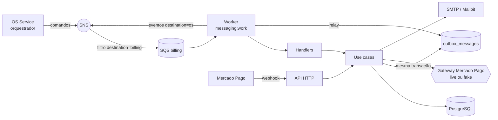

# Auto Repair Billing Service

Microsserviço de **orçamentos e pagamentos** da oficina mecânica (FIAP SOAT, fase 4). Faz parte da saga orquestrada
pelo OS Service: recebe comandos, executa a regra de negócio e responde com eventos.

## Propósito e responsabilidades

- Gerar o orçamento de uma ordem de serviço e enviá-lo por e-mail ao cliente, com links de aprovar/recusar.
- Registrar a decisão do cliente (aprovação ou recusa) e criar a cobrança no Mercado Pago.
- Receber a confirmação do pagamento (webhook) e informar a saga.
- Cancelar orçamentos e estornar pagamentos (compensação da saga).

## Tecnologias

Ruby 3.4.3, Rails 8.1 (API), PostgreSQL 16, RSpec + SimpleCov, rswag (Swagger), lograge (logs JSON), Datadog
(`datadog` + `dogstatsd-ruby`), JWT (HS256), AWS SNS/SQS (LocalStack localmente), Mercado Pago (Net::HTTP), Mailpit (e-mail local).

## Arquitetura

Clean Architecture por contexto, igual ao OS Service:

```
app/domains/billing/   entities, use_cases, services, queries   (orçamentos)
app/domains/payments/  entities, gateways, use_cases, services  (pagamentos / Mercado Pago)
app/domains/identity/  JwtEncoder (somente verificação de tokens)
app/messaging/         handlers das mensagens consumidas
app/lib/messaging/     envelope, bus (SNS), consumer (SQS), outbox, worker
app/controllers/       controllers finos (usam Result)
```



Garantias: entrega *at-least-once* com consumidores idempotentes (`processed_messages`) e publicação via
**transactional outbox** (`outbox_messages`), publicada pelo relay do worker.

### Gateway de pagamento

Porta `Payments::Gateways::Gateway` com dois adaptadores escolhidos por `MERCADO_PAGO_MODE`:

- `live`: `Net::HTTP` contra `https://api.mercadopago.com` (preferência, consulta de pagamento, estorno), timeouts de 5s,
  `X-Idempotency-Key`, erro `Payments::Errors::GatewayError` e métrica `integration.error`.
- `fake` (padrão em dev/test): offline e determinístico. O pagamento é "confirmado" pelo endpoint `simulate`, que executa o
  **mesmo use case** do webhook. `FAKE_MERCADO_PAGO_REFUND_FAILS=true` faz o estorno falhar (demonstra `COMPENSATION_FAILED`).

## Mensagens

Consumidas (destination `billing`):

| type | payload | efeito |
|---|---|---|
| `billing.generate_budget` | `customer`, `vehicle`, `items[]` | cria o orçamento (idempotente por `service_order_uuid`), envia e-mail |
| `billing.cancel_budget` | `reason` | orçamento -> `cancelled` (exceto `paid`/`refunded`) |
| `billing.refund_payment` | `reason` | estorna o pagamento aprovado |

Publicadas (destination `os`, via outbox):

| type | payload |
|---|---|
| `billing.budget_generated` | `budget_id`, `total_cents` |
| `billing.budget_generation_failed` | `reason` (`no_items`, `zero_total`, `invalid_data: ...`) |
| `billing.budget_approved` | `budget_id`, `payment_url` |
| `billing.budget_rejected` | `reason` |
| `billing.budget_cancelled` | `reason` |
| `billing.payment_confirmed` | `payment_id`, `amount_cents`, `provider` |
| `billing.payment_failed` | `payment_id`, `reason` |
| `billing.payment_refunded` | `payment_id`, `refund_id`, `amount_cents` |
| `billing.refund_failed` | `reason` |

`payment_id` é o id interno da tabela `payments`.

## Endpoints

Documentação interativa (Swagger UI): `http://localhost:3001/api-docs`.

| Método | Rota | Autenticação |
|---|---|---|
| GET | `/api/v1/budgets` (`page`, `per_page`, `status`) | JWT admin |
| GET | `/api/v1/budgets/:service_order_uuid` | JWT admin, JWT do cliente dono (`sub` = `customer_id`, senão 403) ou `?token=` |
| POST/GET | `/api/v1/budgets/:service_order_uuid/approve` | JWT do cliente dono ou `?token=` |
| POST/GET | `/api/v1/budgets/:service_order_uuid/reject` | JWT do cliente dono ou `?token=` |
| POST | `/webhooks/mercadopago` | público; valida `x-signature` se `MERCADO_PAGO_WEBHOOK_SECRET` estiver definido |
| POST | `/api/v1/payments/:service_order_uuid/simulate` `{status: approved\|rejected}` | JWT admin, somente `MERCADO_PAGO_MODE=fake` (404 caso contrário) |
| GET | `/up` | público |

Tokens JWT: admin (`aud=admin`, `iss=auto-repair-api`) e cliente (`aud=customer`, `iss=auto-repair-auth`), HS256 com `JWT_SECRET`.
O token do link do e-mail vale 72h; só o digest SHA256 fica no banco.

## Rodando localmente

Tudo roda em Docker (não é necessário Ruby no host):

```bash
docker compose -p billing up -d --build     # api em http://localhost:3001, worker, db, localstack, mailpit
curl http://localhost:3001/up
docker compose -p billing logs -f worker
docker compose -p billing down -v           # derruba e apaga os volumes
```

Somente a porta 3001 é publicada no host. Mailpit e LocalStack ficam acessíveis só dentro da rede do compose
(ex.: `docker compose -p billing exec worker curl -s http://mailpit:8025/api/v1/messages`).

Fluxo completo em modo fake: publique um `billing.generate_budget` no tópico (`auto-repair-local-events`, atributo
`destination=billing`), abra o link de aprovação do e-mail, e confirme o pagamento com
`POST /api/v1/payments/:uuid/simulate` (`{"status":"approved"}`) usando um JWT admin.

## Testes

```bash
docker compose -p billing run --rm -e RAILS_ENV=test api bash -c "bin/rails db:prepare && bundle exec rspec"
docker compose -p billing run --rm api bin/rubocop
docker compose -p billing run --rm api bin/brakeman --no-pager
docker compose -p billing run --rm api bin/bundler-audit
docker compose -p billing run --rm -e RAILS_ENV=test api bundle exec rake rswag:specs:swaggerize   # regenera swagger/v1/swagger.yaml
```

SimpleCov exige cobertura mínima de 80%. Nada de rede real nos testes (WebMock).

## Variáveis de ambiente

| Variável | Descrição | Padrão |
|---|---|---|
| `DATABASE_URL` | conexão PostgreSQL (produção) | - |
| `DB_HOST`, `POSTGRES_USER`, `POSTGRES_PASSWORD` | banco em dev/test | `db`, `postgres`, `postgres` |
| `JWT_SECRET` | segredo HS256 compartilhado | - (obrigatório) |
| `SERVICE_NAME` / `DD_SERVICE` | nome do serviço em logs e métricas | `billing-service` |
| `BILLING_PUBLIC_URL` | URL pública (links do e-mail e `notification_url`) | `http://localhost:3001` |
| `MERCADO_PAGO_MODE` | `fake` ou `live` | `fake` |
| `MERCADO_PAGO_ACCESS_TOKEN` | token do Mercado Pago (`TEST-` usa sandbox) | - |
| `MERCADO_PAGO_WEBHOOK_SECRET` | segredo da assinatura do webhook | - (sem ele, a validação é ignorada com aviso) |
| `FAKE_MERCADO_PAGO_REFUND_FAILS` | `true` força falha no estorno fake | `false` |
| `SMTP_HOST` / `SMTP_PORT` | servidor SMTP | `localhost` / `1025` |
| `MAILER_FROM` | remetente dos e-mails | `no-reply@autorepair.com` |
| `AWS_REGION`, `AWS_ENDPOINT_URL` | SNS/SQS (endpoint só local) | `us-east-1` |
| `AWS_ACCESS_KEY_ID`, `AWS_SECRET_ACCESS_KEY` | credenciais (`test` local; Pod Identity no EKS) | - |
| `EVENTS_TOPIC_ARN`, `QUEUE_URL` | tópico e fila (worker) | - |
| `MESSAGING_AUTO_PROVISION` | `true` cria tópico, fila, DLQ e assinatura (só local) | `false` |
| `EVENTS_TOPIC_NAME`, `QUEUE_NAME` | nomes usados no provisionamento local | `auto-repair-local-events`, `auto-repair-local-billing` |
| `DD_AGENT_HOST`, `DD_ENV`, `DD_VERSION` | Datadog (desligado sem `DD_AGENT_HOST`) | - |

## Observabilidade

Logs JSON (lograge na API, logger JSON no worker) com `service`, `saga_id`, `correlation_id`, `message_id`,
`service_order_uuid` e `dd.trace_id`/`dd.span_id`. Métricas (namespace `auto_repair`): `billing.budget` e `billing.payment`
(tag `status`), `integration.error`, `messaging.published|consumed|failed`.

## CI/CD

Pipeline em [.github/workflows/ci.yml](.github/workflows/ci.yml) (GitHub Actions), independente dos outros serviços:

| Job | Quando | O que faz |
|---|---|---|
| `security` | push e PR | RuboCop, Brakeman e bundler-audit |
| `test` | push e PR | RSpec + Cucumber (BDD) com cobertura; publica `coverage/` e `tmp/cucumber.html` como artefato `test-reports` |
| `quality` | push e PR | análise no SonarQube Cloud (`IgorSantosXP_auto-repair-billing-service`) e espera o Quality Gate |
| `manifests` | push e PR | `kustomize build` dos overlays e `terraform fmt/validate` |
| `deploy` | push em `main` (prod) e `homolog`, só com a variável `DEPLOY_ENABLED=true` (ou *Run workflow*) | `terraform apply` (fila, IAM, RDS), build e push da imagem no ECR, secrets, `kubectl apply` do overlay, rollout da API e do worker e smoke test via API Gateway (espera 401 em /api/v1/budgets) |

A `main` é protegida: só recebe código por Pull Request com os checks `security`, `test`, `quality` e `manifests` verdes.
A autenticação na AWS usa OIDC (role `auto-repair-github-actions`), sem chaves estáticas.

Secrets do repositório: `SONAR_TOKEN`, `MERCADO_PAGO_ACCESS_TOKEN` e `MERCADO_PAGO_WEBHOOK_SECRET` (opcionais; com o token o serviço sobe em modo `live`).

### Infraestrutura própria (Terraform)

[terraform/](terraform/) provisiona apenas o que pertence a este serviço (state em `services/billing/terraform.tfstate`),
lendo do state do `auto-repair-infra-k8s` o cluster, a VPC e o tópico SNS:

- fila SQS `auto-repair-<env>-billing` + DLQ (3 tentativas) assinada no tópico com filtro `destination = billing`;
- role IAM `auto-repair-billing-service` associada ao ServiceAccount via EKS Pod Identity (publicar no SNS, consumir a fila);
- RDS PostgreSQL próprio `auto-repair-billing-db` (bancos `billing_prod` e `billing_homolog`) e o segredo `auto-repair/billing` no Secrets Manager.

```bash
cd terraform && make init && make plan && make up   # make down destrói
```

## Kubernetes

Manifestos com Kustomize em [k8s/](k8s/): `base` (Deployment `api`, Deployment `worker`, Service, HPA 1–4 réplicas por CPU,
ServiceAccount e Job `db-migrate`) e overlays `prod` e `homolog`, cada um em seu namespace
(`auto-repair-billing-prod` / `auto-repair-billing-homolog`). Em prod o Service é exposto também como NodePort `30081`,
alvo do NLB que o API Gateway usa.

```bash
kubectl apply -k k8s/overlays/prod
kubectl -n auto-repair-billing-prod get pods,hpa
```

## Cobertura

Última execução local: **93,15%** de cobertura de linhas (151 exemplos RSpec), mínimo de 80% imposto pelo SimpleCov,
e **5 cenários Cucumber** em [features/orcamento_e_pagamento.feature](features/orcamento_e_pagamento.feature). Na pipeline, o relatório HTML fica no artefato `test-reports` de cada execução
e a cobertura é enviada ao SonarQube Cloud.
